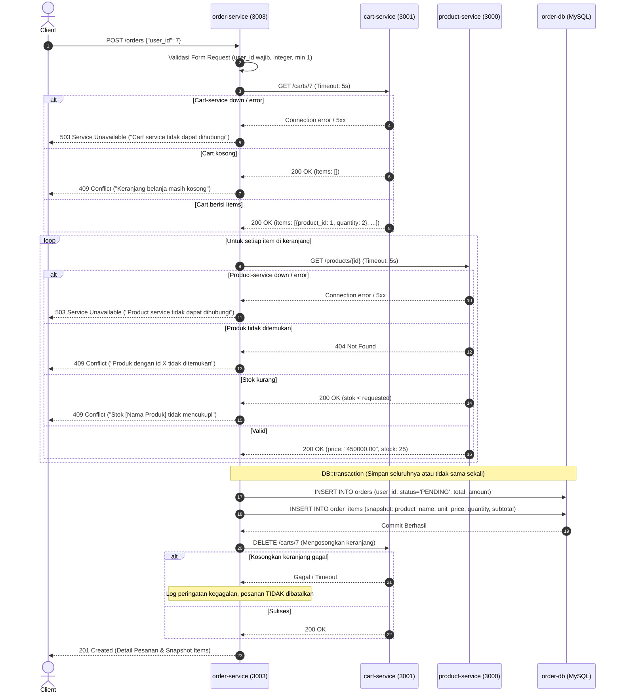

# E-Commerce Microservices System - Order Service

Repositori ini merupakan implementasi sistem microservices e-commerce yang dikembangkan untuk Ujian Tengah Semester (Take Home) mata kuliah Microservices, Program Studi Teknologi Rekayasa Perangkat Lunak, Politeknik Negeri Padang.

Repositori ini mengintegrasikan empat service:
1. **`product-service`** (Node.js/Express & MySQL) — Katalog produk dan inventaris stok (Port `3000`).
2. **`cart-service`** (Laravel & PostgreSQL) — Manajemen keranjang belanja pengguna (Port `3001`).
3. **`review-service`** (Python/Flask & MongoDB) — Ulasan produk oleh pengguna (Port `3002`).
4. **`order-service`** (Laravel & MySQL) — **[Hasil UTS]** Layanan pengolahan pesanan, checkout, transaksi snapshot, dan pembayaran (Port `3003`).

---

## 1. Deskripsi & Arsitektur Sistem

### 1.1 Diagram Arsitektur Microservices

```
                                  +-------------------+
                                  |      Client       |
                                  | (Postman/Insomnia)|
                                  +---------+---------+
                                            |
                  +-------------------------+-------------------------+
                  |                         |                         |
                  v                         v                         v
        +-------------------+     +-------------------+     +-------------------+
        |  product-service  |     |   cart-service    |     |  review-service   |
        |    (Port 3000)    |     |    (Port 3001)    |     |    (Port 3002)    |
        +---------+---------+     +---------+---------+     +---------+---------+
                  |                         |                         |
                  v                         v                         v
             [product-db]               [cart-db]                [review-db]
               (MySQL)                (PostgreSQL)                (MongoDB)
                  ^                         ^
                  |                         |
       HTTP: GET /products/{id}   HTTP: GET /carts/{userId}
                  |               HTTP: DELETE /carts/{userId}
                  |                         |
                  +------------+------------+
                               |
                               v
                     +-------------------+
                     |   order-service   |
                     |    (Port 3003)    |
                     +---------+---------+
                               |
                               v
                          [order-db]
                            (MySQL)
```

### 1.2 Diagram Alur Checkout (`POST /orders`)



---

## 2. Struktur Pembagian Lapisan (`order-service`)

Sesuai ketentuan arsitektur berlapis, `order-service` menerapkan pemisahan tanggung jawab (*separation of concerns*):

```
order-service/
├── app/
│   ├── Clients/              # Lapisan Komunikasi HTTP Eksternal
│   │   ├── CartClient.php    # Panggilan ke cart-service (timeout max 5s, tangani 503 & logging)
│   │   └── ProductClient.php # Panggilan ke product-service (konversi harga string -> float, stok check)
│   ├── Exceptions/           # Lapisan Penanganan Error Khusus
│   │   ├── CartServiceUnavailableException.php     (HTTP 503)
│   │   ├── ProductServiceUnavailableException.php  (HTTP 503)
│   │   ├── EmptyCartException.php                  (HTTP 409)
│   │   ├── ProductNotFoundException.php            (HTTP 409)
│   │   ├── InsufficientStockException.php          (HTTP 409)
│   │   ├── InvalidOrderStatusException.php         (HTTP 409)
│   │   └── OrderNotFoundException.php              (HTTP 404)
│   ├── Http/
│   │   ├── Controllers/
│   │   │   └── OrderController.php  # Menangani HTTP request/response, try-catch, format 200/201/404/409/503/500
│   │   └── Requests/
│   │       ├── CreateOrderRequest.php   # Validasi payload POST /orders (HTTP 422)
│   │       └── GetUserOrdersRequest.php # Validasi query ?status= (HTTP 422)
│   ├── Models/
│   │   ├── Order.php         # Model Eloquent orders, relasi hasMany(OrderItem), scopeForUser
│   │   └── OrderItem.php     # Model Eloquent order_items, relasi belongsTo(Order), snapshot fields
│   └── Services/
│       └── OrderService.php  # Lapisan Logika Bisnis (DB::transaction, kalkulasi snapshot, aturan checkout)
├── database/
│   └── migrations/           # Skema database orders dan order_items
├── routes/
│   └── api.php               # Pendaftaran endpoint REST API & parameter routing constraint
├── tests/
│   └── Feature/              # Pengujian otomatis seluruh skenario sukses dan gagal
└── Dockerfile                # Resep container image PHP 8.4-cli + pdo_mysql
```

---

## 3. Langkah Menjalankan Seluruh Sistem

### 3.1 Prasyarat
- Docker Engine & Docker Compose (v2.x atau lebih baru).
- Port berikut belum digunakan oleh aplikasi lain di komputer:
  - `3000` (product-service)
  - `3001` (cart-service)
  - `3002` (review-service)
  - `3003` (order-service)
  - `3306` (product-db)
  - `3307` (order-db)
  - `5432` (cart-db)
  - `27017` (review-db)

### 3.2 Menjalankan via Docker Compose
Jalankan satu perintah berikut di root repositori:

```bash
docker compose up --build
```

Docker Compose akan secara otomatis:
1. Membangun seluruh service image (`product-service`, `cart-service`, `review-service`, `order-service`).
2. Menyalakan database container dengan *health check*.
3. Menjalankan migrasi database otomatis saat container menyala (`php artisan migrate --force`).
4. Membuka port layanan yang siap diakses.

Untuk mematikan seluruh sistem beserta volume data:
```bash
docker compose down -v
```

---

## 4. Spesifikasi Endpoint & Contoh Request/Response

### 4.1 `GET /health`
Mengecek apakah `order-service` hidup.
- **Request:**
  ```http
  GET http://localhost:3003/health
  ```
- **Response Sukses (200 OK):**
  ```json
  {
    "status": "ok",
    "service": "order-service"
  }
  ```

---

### 4.2 `POST /orders` (Checkout Pesanan)
Membuat pesanan baru dari isi keranjang belanja user.

- **Request Sukses:**
  ```http
  POST http://localhost:3003/orders
  Content-Type: application/json

  {
    "user_id": 7
  }
  ```
- **Response Sukses (201 Created):**
  ```json
  {
    "message": "Pesanan berhasil dibuat",
    "data": {
      "id": 1,
      "user_id": 7,
      "status": "PENDING",
      "total_amount": 1050000,
      "items": [
        {
          "product_id": 1,
          "product_name": "Keyboard Mekanikal",
          "unit_price": 450000,
          "quantity": 2,
          "subtotal": 900000
        },
        {
          "product_id": 2,
          "product_name": "Mouse Wireless",
          "unit_price": 150000,
          "quantity": 1,
          "subtotal": 150000
        }
      ],
      "created_at": "2026-10-20T03:15:00+00:00",
      "updated_at": "2026-10-20T03:15:00+00:00"
    }
  }
  ```

- **Response Gagal - Validasi Body Tidak Valid (422 Unprocessable Content):**
  ```http
  POST http://localhost:3003/orders
  Content-Type: application/json

  {}
  ```
  ```json
  {
    "message": "Data yang dikirim tidak valid",
    "errors": {
      "user_id": [
        "Field user_id wajib diisi"
      ]
    }
  }
  ```

- **Response Gagal - Keranjang Kosong (409 Conflict):**
  ```json
  {
    "message": "Keranjang belanja masih kosong"
  }
  ```

- **Response Gagal - Stok Tidak Mencukupi (409 Conflict):**
  ```json
  {
    "message": "Stok Monitor 24 Inch tidak mencukupi: diminta 11, tersedia 10"
  }
  ```

- **Response Gagal - Produk Tidak Ditemukan di Katalog (409 Conflict):**
  ```json
  {
    "message": "Produk dengan id 99 tidak ditemukan"
  }
  ```

- **Response Gagal - Product Service Tidak Dapat Dihubungi (503 Service Unavailable):**
  ```json
  {
    "message": "Product service tidak dapat dihubungi, coba lagi nanti"
  }
  ```

---

### 4.3 `GET /orders/{id}`
Mengambil detail satu pesanan beserta rincian item snapshot.

- **Request Sukses:**
  ```http
  GET http://localhost:3003/orders/1
  ```
- **Response Sukses (200 OK):**
  ```json
  {
    "message": "Berhasil mengambil pesanan",
    "data": {
      "id": 1,
      "user_id": 7,
      "status": "PENDING",
      "total_amount": 1050000,
      "items": [
        {
          "product_id": 1,
          "product_name": "Keyboard Mekanikal",
          "unit_price": 450000,
          "quantity": 2,
          "subtotal": 900000
        }
      ],
      "created_at": "2026-10-20T03:15:00+00:00",
      "updated_at": "2026-10-20T03:15:00+00:00"
    }
  }
  ```

- **Response Gagal - Pesanan Tidak Ditemukan (404 Not Found):**
  ```http
  GET http://localhost:3003/orders/999
  ```
  ```json
  {
    "message": "Pesanan dengan id 999 tidak ditemukan"
  }
  ```

---

### 4.4 `GET /orders/user/{userId}`
Mengambil daftar pesanan milik satu pengguna tertentu (terbaru di atas).

- **Request Sukses dengan Filter Status:**
  ```http
  GET http://localhost:3003/orders/user/7?status=PENDING
  ```
- **Response Sukses (200 OK):**
  ```json
  {
    "message": "Berhasil mengambil daftar pesanan",
    "data": [
      {
        "id": 1,
        "user_id": 7,
        "status": "PENDING",
        "total_amount": 1050000,
        "items": [ ... ],
        "created_at": "2026-10-20T03:15:00+00:00",
        "updated_at": "2026-10-20T03:15:00+00:00"
      }
    ]
  }
  ```

- **Response Gagal - Status Tidak Valid (422 Unprocessable Content):**
  ```http
  GET http://localhost:3003/orders/user/7?status=SHIPPED
  ```
  ```json
  {
    "message": "Data yang dikirim tidak valid",
    "errors": {
      "status": [
        "Status harus PENDING atau PAID"
      ]
    }
  }
  ```

---

### 4.5 `PATCH /orders/{id}/pay`
Simulasi pembayaran pesanan (mengubah status pesanan dari `PENDING` menjadi `PAID`).

- **Request Sukses:**
  ```http
  PATCH http://localhost:3003/orders/1/pay
  ```
- **Response Sukses (200 OK):**
  ```json
  {
    "message": "Pesanan berhasil dibayar",
    "data": {
      "id": 1,
      "user_id": 7,
      "status": "PAID",
      "total_amount": 1050000,
      "items": [ ... ],
      "created_at": "2026-10-20T03:15:00+00:00",
      "updated_at": "2026-10-20T04:02:00+00:00"
    }
  }
  ```

- **Response Gagal - Status Bukan PENDING (409 Conflict):**
  ```json
  {
    "message": "Pesanan berstatus PAID, hanya pesanan PENDING yang dapat dibayar"
  }
  ```

- **Response Gagal - Pesanan Tidak Ada (404 Not Found):**
  ```json
  {
    "message": "Pesanan dengan id 999 tidak ditemukan"
  }
  ```

---

## 5. Daftar Environment Variable

| Variable | Default Value | Deskripsi |
|---|---|---|
| `APP_NAME` | `order-service` | Nama aplikasi |
| `APP_ENV` | `production` / `local` | Environment running Laravel |
| `APP_KEY` | `base64:...` | Enkripsi key Laravel (32 bytes base64) |
| `APP_DEBUG` | `true` / `false` | Mode debug (detail teknis hanya tampil saat `true`) |
| `APP_URL` | `http://localhost:3003` | URL dasar service |
| `DB_CONNECTION` | `mysql` | Driver koneksi database |
| `DB_HOST` | `order-db` / `127.0.0.1` | Host database MySQL order-service |
| `DB_PORT` | `3306` (container) / `3307` (host) | Port MySQL order-service |
| `DB_DATABASE` | `orderdb` | Nama database MySQL order-service |
| `DB_USERNAME` | `appuser` | Username database MySQL |
| `DB_PASSWORD` | `apppassword` | Password database MySQL |
| `PRODUCT_SERVICE_URL` | `http://product-service:3000` | Alamat endpoint product-service |
| `PRODUCT_SERVICE_TIMEOUT` | `5` | Batas waktu timeout HTTP request (maksimal 5 detik) |
| `CART_SERVICE_URL` | `http://cart-service:3001` | Alamat endpoint cart-service |
| `CART_SERVICE_TIMEOUT` | `5` | Batas waktu timeout HTTP request (maksimal 5 detik) |
| `LOG_CHANNEL` | `stderr` / `stack` | Channel output logging sistem |

---

## 6. Keputusan Desain & Keterbatasan Sistem

### 6.1 Keputusan Desain
1. **Snapshotting Nama dan Harga Produk:**
   - **Keputusan:** Nilai `product_name` dan `unit_price` disimpan langsung pada baris tabel `order_items` saat pesanan dibuat.
   - **Trade-off:** Terjadi denormalisasi data antara katalog produk dan pesanan.
   - **Alasan:** Harga dan nama produk pada katalog bisa berubah atau produk bisa dihapus kapan saja oleh pengelola toko. Pesanan historis yang sudah dibuat pelanggan tidak boleh terpengaruh oleh perubahan harga masa depan demi keabsahan data akuntansi.

2. **Transaksi Database Atomik (`DB::transaction`):**
   - **Keputusan:** Penyimpanan tabel `orders` dan seluruh item `order_items` dieksekusi di dalam satu blok transaksi database InnoDB MySQL.
   - **Alasan:** Mencegah terjadinya *partial write* (*data orphan*), sehingga sistem menjamin pesanan tersimpan lengkap atau gagal secara keseluruhan.

3. **Penanganan Kegagalan Pengosongan Keranjang (*Fault-Tolerant Checkout*):**
   - **Keputusan:** Apabila pesanan sudah berhasil dicatat di database tetapi permintaan `DELETE /carts/{userId}` ke `cart-service` mengalami kegagalan/timeout, transaksi pesanan **tidak di-rollback**. Service tetap mengembalikan HTTP 201 Created dan mencatat kegagalan di log level `warning`.
   - **Alasan:** Sesuai aturan bisnis pada spesifikasi ujian, pesanan yang sah sudah terbentuk. Membatalkan transaksi pesanan hanya karena kegagalan jaringan saat menghapus keranjang akan merugikan pelanggan dan membuka risiko *duplicate charge*.

4. **Pemisahan Database per Layanan (*Database per Service Pattern*):**
   - **Keputusan:** `order-service` memiliki instance container MySQL terpisah (`order-db` port `3307`) dan sama sekali tidak mengakses database milik `product-service` maupun `cart-service`.
   - **Alasan:** Menjaga isolasi data (*loose coupling*), independensi skema database, dan otonomi *lifecycle* tiap service.

### 6.2 Keterbatasan Solusi & Pengembangan Mendatang
- **Distributed Transaction / Saga Pattern:** Saat ini, komunikasi sinkron via HTTP REST digunakan antar service. Jika dalam skala produksi terjadi kegagalan jaringan saat cart dikosongkan, diperlukan mekanisme kompensasi atau *event-driven architecture* (menggunakan RabbitMQ/Kafka) dengan pola *Saga Orchestration*.
- **Circuit Breaker:** Panggilan ke service eksternal sudah dilengkapi timeout 5 detik dan penanganan 503, namun belum mengimplementasikan *circuit breaker pattern* otomatis untuk mencegah *cascading failure* saat beban tinggi.

---

## 7. Panduan Video Demo UTS

Bawakan video demo (durasi 8–15 menit) seperti presentasi arsitektural kepada seorang Tech Lead dengan alur berikut:
1. **Pembukaan (~1 menit):** Perkenalan Nama, NIM, dan ringkasan arsitektur `order-service`.
2. **Arsitektur & Pemisahan Lapisan (~2 menit):** Jelaskan alur komunikasi REST antar-service dan peranan masing-masing lapisan (`Clients`, `Services`, `Requests`, `Controllers`, `Models`).
3. **Menjalankan Sistem (~1 menit):** Tunjukkan terminal saat menjalankan `docker compose up --build` dari kondisi bersih.
4. **Demo Skenario Endpoint (~4–6 menit):**
   - `GET /health` (200 OK)
   - `POST /orders` Sukses (201 Created)
   - `POST /orders` Validasi gagal tanpa `user_id` (422)
   - `POST /orders` Keranjang kosong (409)
   - `POST /orders` Stok tidak mencukupi, misal 11 unit Monitor 24 Inch (409)
   - `POST /orders` saat `product-service` dimatikan menggunakan `docker compose stop product-service` (503 Service Unavailable) beserta tampilan log-nya
   - **Snapshot Bukti:** Ubah harga produk di `product-service` dan buktikan harga pada pesanan lama di `order-service` tetap tidak berubah.
   - `GET /orders/{id}` Sukses (200) dan gagal (404)
   - `GET /orders/user/{userId}` dengan filter `?status=PENDING` dan gagal `?status=SHIPPED` (422)
   - `PATCH /orders/{id}/pay` Sukses (200 PENDING -> PAID) dan gagal saat dibayar ulang (409)
5. **Keputusan Desain & Trade-off (~1-2 menit):** Paparkan keputusan snapshotting data, penanganan keranjang gagal dikosongkan, dan pembatasan transaksi database lokal.
6. **Penutup.**
